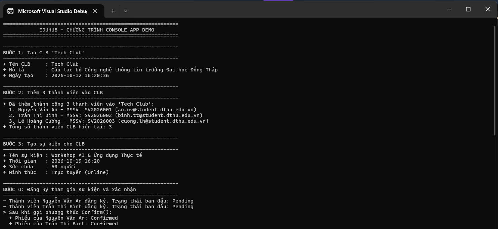
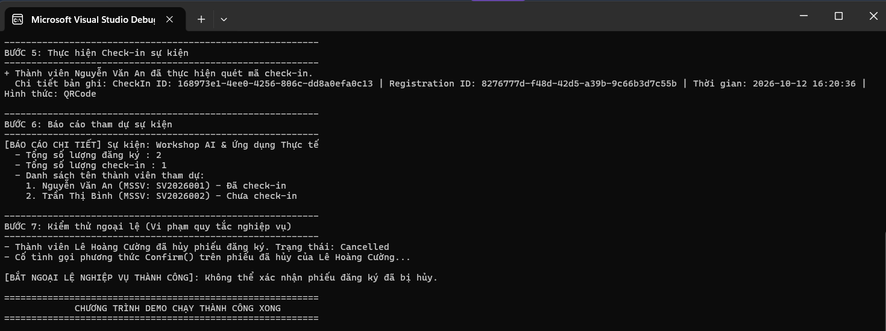

# Giới thiệu bản thân

- **Họ và tên:** Nguyễn Lê Phúc Thịnh
- **Mã số sinh viên:** 0024416432
- **Lớp:** ĐHCNTT24A-IT
- **Mục tiêu:** Thực hành: Pull Request đầu tiên

## Mô tả thiết kế Domain
EduHub là hệ thống quản lý Câu lạc bộ & Sự kiện sinh viên của Trường Đại học Đồng Tháp[cite: 8]. Mô hình miền (Domain Model) trong Chương 1 bao gồm 5 thực thể cốt lõi sau:
1. **Member**: Đại diện cho thành viên sinh viên của CLB, quản lý thông tin cá nhân và trạng thái hoạt động.
2. **Club**: Đại diện cho câu lạc bộ sinh viên, chứa danh sách thành viên và tổ chức các sự kiện.
3. **Event**: Sự kiện do CLB tổ chức, quản lý thông tin thời gian, sức chứa và hình thức tổ chức (Online/Offline).
4. **Registration**: Phiếu đăng ký tham dự sự kiện của thành viên (bảng nối mối quan hệ nhiều-nhiều giữa Member và Event, quản lý trạng thái Pending/Confirmed/Cancelled).
5. **CheckIn**: Ghi nhận điểm danh tham gia thực tế tại sự kiện dựa trên phiếu đăng ký.

## Hướng dẫn cách chạy ứng dụng bằng Visual Studio
1. Mở phần mềm **Visual Studio**.
2. Chọn **Open a project or solution** và trỏ đến file dự án `EduHub.Ch01.csproj` (hoặc `.sln`).
3. Nhấn tổ hợp phím **`Ctrl + F5`** (hoặc bấm nút mũi tên màu xanh **Start**) trên thanh công cụ để chạy chương trình Console.

